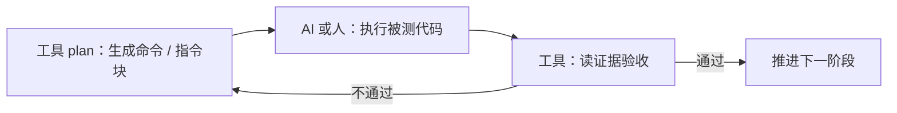

# refactor-pilot 🛠️

> **工程化补课 + 流程护栏**工具：可靠发现工程化缺失、提示配置矛盾；把缺失型问题拆成可验收的阶段，
> 用检查点护栏驱动「**工具规划 → AI 执行 → 工具验收**」的改造流程。
> 它**不**验证语义正确性 —— 后者只有开启对拍（Q6）或人工深度审计才能覆盖。

[](https://www.python.org/downloads/)
[](https://docs.astral.sh/ruff/)
[](https://mypy-lang.org/)
[](docs/design-v2.md)

---

## 📑 目录

- [✨ 特性](#features)
- [🚀 快速开始](#quickstart)
- [🚧 它不做什么](#scope)
- [🔄 工作方式：指挥官模式](#mode)
- [📖 命令参考](#commands)
- [🗂️ 当前能力 / 已验证项目](#status)
- [🛡️ 只读是结构保证](#readonly)
- [⚠️ 已知局限](#limits)
- [📦 项目结构](#structure)
- [🛠️ 开发](#develop)
- [📚 文档与链接](#docs)

---

<a id="features"></a>

## ✨ 特性

- **只读扫描（S1）**：只采集事实，不做判定 —— 九个字段族，覆盖工具链、依赖、约定、源布局等。
- **审计规则包（S2）**：按规则包判定（A/B/C/G/I 等组），区分缺失型 / 存在型，标严重度与置信度。
- **召回率自检（recall）**：用「三段法」基线反查规则库，防止「规则能报、但测不出真问题」的虚假覆盖。
- **改造切片（S5，实验）**：`A 开工核对 → B 实现 → D 实跑验收 → E 提交拆分`，四格检查点护栏。
- **结构级只读**：文件访问层只导出读 API，全项目唯一写入口是产物目录，且默认落在仓库之外。
- **零运行时依赖**：工具跑在自己的环境里，绝不装进被审计项目的环境（详见 [开发](#develop)）。

---

<a id="quickstart"></a>

## 🚀 快速开始

```bash
# 1. 准备环境
source .venv/bin/activate        # 复用仓库内 .venv
pip install -e .                 # 装出 refactor-pilot 命令行（上方用法入口）

# 2. 一条命令驱动改造循环：反复运行即逐阶段推进
refactor-pilot upgrade <path>
```

`upgrade` 会先 `scan + audit + plan`，然后逐阶段推进。**工具只生成命令与指令块，不执行被测代码 /
git 写操作**（"指挥官模式"），由 AI/人执行，工具下次运行**读证据**判定。产物默认落在**仓库之外**。

> 不装也行：`pytest` 靠 `conftest.py` 把 `src/` 加进 `sys.path`，照样跑得起来，但那样**没有
> `refactor-pilot` 命令**。想不装直接用：
> `PYTHONPATH=src python -m refactor_pilot ...`

---

<a id="scope"></a>

## 🚧 它不做什么（写死，永不消失）

以下三类**不在本工具覆盖范围内**，无论是否开启对拍都一样（审计报告里也**无条件**输出这段声明，见 design-v2 1.5）：

- 逻辑与数值正确性
- 语义等价性（重构前后行为是否一致）
- 性能回归

---

<a id="mode"></a>

## 🔄 工作方式：指挥官模式

工具是「指挥官」：规划与验收由工具完成，执行交给你 / AI。每一阶段都是 **生成计划 → 执行 → 读证据验收** 的闭环，验收不通过就回头重做，不静默放过任何一条 finding。



底层子命令（一般用不到，`upgrade` 已封装）：

```
refactor-pilot scan  <path> [--ref REF] [--out DIR] [--snapshot {worktree,archive}]
                            [--exec-probe {on,off}] [--json] [-v]
refactor-pilot audit <path> [--ref REF] [--out DIR] [--rules FILE] [--json]
refactor-pilot recall --audit FILE --baseline FILE [--json] [--detail]
refactor-pilot plan  <path> [--ref REF] [--out DIR] [--rules FILE] [--json]
refactor-pilot s5    <path> --plan FILE [--out DIR] [--stage-id ID] [--cell {a,b,d,e}] [--test-cmd CMD]
refactor-pilot upgrade <path> [--ref REF] [--out DIR] [--test-cmd CMD] [--cell {a,b,d,e}]
```

退出码：`0` 成功（**发现问题不算错**）／`1` 运行时错误／`2` 用法错误／`3` 目标不支持。

---

<a id="commands"></a>

## 📖 命令参考

| 命令 | 作用 | 关键选项 |
| ---- | ---- | ---- |
| `scan` | S1 扫描：只采集事实，不做判定 | `--ref` `--out` `--snapshot` `--exec-probe` `--json` `-v` |
| `audit` | S2 审计：按规则包判定 | `--ref` `--out` `--rules` `--snapshot` `--json` |
| `plan` | 把 audit 缺失型 finding 自动转成 plan | `--ref` `--out` `--rules` `--snapshot` `--json` |
| `s5` | 跑单个改造切片（A/B/D/E 某一格） | `--plan` `--stage-id` `--cell` `--test-cmd` `--out` |
| `upgrade` | 单命令驱动循环：反复运行逐阶段推进 | `--ref` `--rules` `--snapshot` `--test-cmd` `--cell` `--out` |
| `recall` | 召回率自检（需 `--baseline` 由人提供） | `--audit` `--baseline` `--detail` `--json` |

> 存在型基线**由人提供，工具不自己生成**（否则召回率虚高）。详见 [CODEBUDDY.md](CODEBUDDY.md)。

---

<a id="status"></a>

## 🗂️ 当前能力 / 已验证项目

**当前能力**

- **只读分析**：**S1 扫描 + S2 审计 + recall 召回率自检**
- **改造切片（S5，实验）**：`A 开工核对 → B 实现 → D 实跑验收 → E 提交拆分`

**已验证的项目（三个）**

| 项目 | 类型 | 结论 |
| ---- | ---- | ---- |
| v1（`/tmp/rp-toy-v1`） | 脚本型仓库 | **缺失型补课** 4/5 关（B01 设计性跳过，脚本导入即副作用）；**存在型**正例已耗尽 |
| toy2 | 小项目 | **S5 四格 A/B/D/E 用真实 pytest 走通**，工具全程未执行被测代码 |
| nanogpt-plus（`/tmp/rp-toy-nanogpt`） | 正常包 + 真测试 + 包内假测试 | **首轮真正的"质量优化"**：`upgrade` 三阶段跑通；工具交接的 B02（6 个导入即执行副作用的假测试）由 AI 判断**移出包**（而非硬加断言）后，重跑 audit **B02 归零且无新 finding** |

**当前方向与验收口径**见 [`docs/process.md`](docs/process.md) 顶部的"原始需求 + 三门"。

---

<a id="readonly"></a>

## 🛡️ 只读是结构保证

- 文件访问层 `fsutil` **只导出读 API**，扫描链路上的代码拿不到写能力
- 全项目唯一的写入口是 `outdir`
- 产物默认写到**仓库之外**：`./refactor-pilot-out/<项目名>/.upgrade/`
- `--ref` 时在临时目录审计（worktree / archive），进程内绝不执行 git commit / push

---

<a id="limits"></a>

## ⚠️ 已知局限

1. **Q6 信号会误命中**：任何名字含 `baseline/expected/golden/reference` 的数据文件都被算作"数值基线"信号。阈值是 ≥2 个信号才建议 Q6 默认开，单条误命中影响有限，但别把它当强信号。
2. **`--exec-probe on` 且无 `--ref` 时是在目标工作目录里跑被测代码**（会打印警告）。建议始终配合 `--ref`。
3. **模块名只认有证据的 source root**（打包声明 + 入口脚本所在目录）。既没有打包声明、又没有 `__main__` 守卫的脚本目录（如 `archives/`），其兄弟 import 会被标成 `third_party` —— 宁可漏判，也不把"仓库里有的模块"说成不存在（见 12.12）。
4. **测试文件只要文件名像测试就算数**（12.4 只看文件名）。因此"有断言但 `testpaths` 之外、pytest 永不收集"的死测试当前**报不出来**（候选规则 B08，见 `docs/process.md` 技术债 D-07）。

---

<a id="structure"></a>

## 📦 项目结构

```
refactor-pilot/
├── src/refactor_pilot/
│   ├── cli.py            # argparse 入口 + 子命令分发
│   ├── fsutil.py         # 唯一只读文件 API 层（只导出读 API）
│   ├── outdir.py         # 唯一写入口（产物落仓库外）
│   ├── gitutil.py        # git 只读封装（写命令白名单拦截）
│   ├── snapshot.py       # --ref 临时快照（worktree / archive）
│   ├── model.py          # 契约数据结构 + 退出码常量
│   ├── scan/             # S1 扫描器（九个字段族）
│   ├── audit/            # S2 审计器（规则包 A/B/C/G/I）
│   ├── s5/               # S5 改造切片（A/B/D/E 四格）
│   ├── recall.py         # 召回率自检
│   └── autoplan.py       # audit finding → plan 自动转换
├── tests/                # 123 个用例（含只读专项）
├── docs/
│   ├── design-v2.md      # 权威规格 / 规则 / 口径
│   └── process.md        # 进展流水 + 原始需求（"三门"北极星）
└── CODEBUDDY.md          # 本仓库的协作与约束入口指针
```

---

<a id="develop"></a>

## 🛠️ 开发

```bash
source .venv/bin/activate
pip install -e .          # 装出 refactor-pilot 命令行（上面用法里的入口）
pytest                    # 含只读专项测试：扫完 git status 干净 + 文件指纹不变
ruff check .
mypy
```

不装也行（`pytest` 靠 `conftest.py` 把 `src/` 加进 `sys.path`，照样跑得起来），但那样
**没有 `refactor-pilot` 命令**。想不装直接用：`PYTHONPATH=src python -m refactor_pilot ...`。

---

<a id="docs"></a>

## 📚 文档与链接

- [`docs/design-v2.md`](docs/design-v2.md) —— 权威设计文档（规则定义、范围、实现口径、验收清单）。改规则先改里面的表。
- [`docs/process.md`](docs/process.md) —— 进展流水 + 原始需求"三门"（方向判定的北极星，**不可由后续讨论覆盖**）。
- [`CODEBUDDY.md`](CODEBUDDY.md) —— 给 AI 协作本的硬约束与入口指针（必读）。
